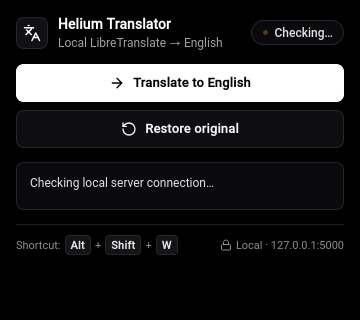

# Libre Local Translator

<div align="center">



**High-performance, 100% private, on-device webpage translation for Chromium browsers powered by a local LibreTranslate engine.**

[](https://developer.chrome.com/docs/extensions/mv3/intro/)
[](#part-2-browser-installation-guide)
[](LICENSE)
[](#privacy--security-guarantee)
[](#automated-test-suite)

[Features](#key-features) • [Engine Deep Dive](#deep-dive-advanced-engine-capabilities) • [Quick Start](#quick-start-30-second-overview) • [LibreTranslate Setup](#part-1-setting-up-libretranslate-local-server) • [Browser Install](#part-2-browser-installation-guide) • [Tests (50 Passing)](#automated-test-suite) • [Troubleshooting](#part-4-troubleshooting--faq)

</div>

---


**Note** : This is tried and tested on Arch linux, it might not work properly on other OS, feel free to try it and raise issues or contribute yourself if you can.


<a id="key-features"></a>
## Why Local Translator?

Most web page translators route every word of every site you visit through external corporate cloud APIs (Google, Microsoft, DeepL). **Libre Local Translator** runs entirely on your local machine:

- **100% Private & Air-Gapped Capable**: All translation models run locally at `http://127.0.0.1:5000`. Zero network traffic leaves your computer. No accounts, no API tokens, no tracking.
- **Inline Element Sentence Stitching**: Solves sentence fragmentation across inline formatting tags (`<a>`, `<span>`, `<strong>`, `<em>`, `<code>`, ``, etc.) using synthetic `<x id="...">` placeholders and AST-aware DOM reconstruction, preserving natural syntax and cross-language word reordering.
- **Dynamic Content & SPA MutationObserver**: Debounced `MutationObserver` automatically detects dynamically rendered content (React, Vue, Next.js, infinite scroll feeds, client-side routing) and queues newly injected subtrees with zero self-mutation infinite loops.
- **Attribute Translation**: Automatically extracts and translates user-visible text in `placeholder` (inputs & textareas), `title` tooltips, `alt` text on images, and `aria-label` accessibility descriptors.
- **Smart DOM Walker & Subtree Pruning**: Uses `NodeFilter.FILTER_REJECT` to skip entire non-translatable DOM subtrees (`<script>`, `<style>`, `<code>` blocks, `<pre>`, `<svg>`, hidden containers) in a single step rather than walking thousands of irrelevant elements.
- **In-Page Phrase Deduplication**: Groups repeated phrases (menus, footers, buttons, recurring terms). Only unique phrases are sent for translation, and all matching DOM nodes are updated simultaneously. Reduces model inference load and latency by **30% to 60%**.
- **Viewport-First Prioritization**: Text in the visible viewport is translated first so you can start reading immediately. Off-screen batches yield to the browser idle loop (`requestIdleCallback`) to maintain 60 FPS scrolling.
- **Shared In-Flight Requests & LRU Cache**: Background service worker maintains an in-memory LRU cache (2,000 phrases) and collapses concurrent duplicate requests into a single promise.
- **One-Click Instant Rollback**: Revert any translated page to its exact original text in milliseconds, with whitespace, punctuation, attribute values, and child node trees preserved.
- **Comprehensive CJK & Unicode Support**: Full support for Chinese, Japanese, Korean logograms, single-letter European words, Cyrillic, Indic, and Arabic scripts.
- **Modern Accessible UI**: Real-time ping latency check, live tab translation state sync, progress bar with phrase and node metrics, and full WCAG AA dark/light mode.

---

## Quick Start (30-Second Overview)

```sh
# 1. Start local LibreTranslate server using Docker (persists models)
docker compose up -d

# 2. Check that the server is online and English is available
curl -s http://127.0.0.1:5000/languages | grep '"code":"en"'

# 3. Load the extension in your browser:
#    Open chrome://extensions (or your browser's extension page)
#    Enable "Developer mode" -> Click "Load unpacked" -> Select this repository folder
```

---

## Architecture Overview

```
┌────────────────────────────────────────────────────────────────────────┐
│                        Chromium Webpage (DOM)                          │
│                                                                        │
│  [Visible Viewport Nodes]              [Off-screen Content Nodes]      │
│  [Inline Stitched Segments]            [Input / Alt / ARIA Attributes] │
│  [MutationObserver Dynamic Subtrees]   [Client-Side Routed SPAs]       │
└──────────────────┬──────────────────────────────────┬──────────────────┘
                   │                                  │
      (TreeWalker & Tag Partitioning)     (requestIdleCallback Yielding)
      (Synthetic <x id="..."> Masking)   (250ms Debounced Mutation Queue)
                   │                                  │
                   ▼                                  ▼
┌────────────────────────────────────────────────────────────────────────┐
│                      content.js (Content Script)                       │
│  - Contiguous inline element stitching & AST placeholder masking       │
│  - Attribute translation (placeholder, title, alt, aria-label)         │
│  - Dynamic content MutationObserver (self-mutation loop guards)        │
│  - Text sanitization & whitespace preservation                         │
│  - In-page phrase deduplication (unique string groups)                 │
│  - Viewport-first priority queue & zero-width marker DOM replacement   │
│  - Full original state map (nodes, attributes, segment hierarchies)    │
└──────────────────────────────────┬─────────────────────────────────────┘
                                   │ chrome.runtime.sendMessage
                                   │ { action: "translateBatch", format: "html" }
                                   ▼
┌────────────────────────────────────────────────────────────────────────┐
│                    background.js (Service Worker)                      │
│  - In-memory LRU Cache (2,000 entries)                                 │
│  - In-flight request deduplication map (shared Promises)               │
│  - HTML markup format preservation for <x id="..."> synthetic tags     │
│  - 150-second timeout guard & error isolation                          │
└──────────────────────────────────┬─────────────────────────────────────┘
                                   │ HTTP POST /translate (format: html)
                                   ▼
┌────────────────────────────────────────────────────────────────────────┐
│           Local LibreTranslate Engine (http://127.0.0.1:5000)          │
│  - Argos Translate / CTranslate2 local neural machine translation      │
│  - Multi-threaded CPU or CUDA GPU acceleration                         │
└────────────────────────────────────────────────────────────────────────┘
```

---

## Deep Dive: Advanced Engine Capabilities

Libre Local Translator goes beyond naive text-node replacement by incorporating a production-grade DOM translation engine built for modern, complex web applications.

### 1. Inline Element Sentence Stitching

#### The Sentence Fragmentation Problem
Traditional webpage translators traverse the DOM text node by text node. When encountering HTML like:
```html
<p>Please read our <a href="/terms">terms of service</a> and <strong>privacy policy</strong> carefully before proceeding.</p>
```
A naive DOM walker isolates each individual text node:
1. `"Please read our "`
2. `"terms of service"`
3. `" and "`
4. `"privacy policy"`
5. `" carefully before proceeding."`

Sending these fragments individually to a neural machine translation engine produces broken results:
- **Grammar & Context Loss**: The translation model translates each piece without the context of the complete sentence. Polysemous words (e.g. `"terms"` or `"policy"`) lose their meaning.
- **Word Order Distortion**: Different languages follow different syntactic structures (e.g., Subject-Verb-Object vs. Subject-Object-Verb). In German, Japanese, Hindi, or Turkish, adjectives, verbs, and prepositional phrases routinely shift positions. Translating isolated fragments makes it impossible to reorder words naturally, rendering the output scrambled or nonsensical.

#### Synthetic Placeholder Masking (`<x id="...">`)
To solve sentence fragmentation, Libre Local Translator implements an AST-aware run partitioner:
1. **Contiguous Run Partitioning**: `collectTranslatableItems` partitions sibling child nodes within block elements (`<p>`, `<div>`, `<li>`, etc.) into continuous runs of text and inline formatting tags (`INLINE_TAGS`: `<a>`, `<span>`, `<strong>`, `<em>`, `<code>`, `<b>`, `<i>`, `<u>`, `<small>`, `<sub>`, `<sup>`, `<abbr>`, `<time>`, ``, etc.). Block-level tags (`<div>`, `<p>`, `<h1>`–`<h6>`, `<br>`) act as natural sentence boundaries and trigger segment flushes.
2. **Synthetic XML Tokenization**: `maskSegment` serializes the run into a single unified sentence, replacing inline elements with lightweight, unique synthetic XML tags:
   - Elements with content: `<x id="0">terms of service</x>`
   - Void or empty elements (e.g. ``): `<x id="1"/>`
   - Example serialized string:
     `Please read our <x id="0">terms of service</x> and <x id="1">privacy policy</x> carefully before proceeding.`
3. **HTML Format Transmission**: The request is dispatched to LibreTranslate with `format: "html"`. The Argos Translate / CTranslate2 neural translation pipeline recognizes HTML tags as non-translatable structure tokens, translating only the natural language while keeping placeholder tags intact and grammatically repositioned.

#### Non-Destructive DOM Reconstruction (`parseTranslatedMarkup`)
Once translated markup is returned (e.g. `Bitte lesen Sie unsere <x id="0">Nutzungsbedingungen</x> und <x id="1">Datenschutzrichtlinie</x> sorgfältig durch, bevor Sie fortfahren.`):
1. **Element Recycling**: Rather than destroying DOM nodes with `innerHTML` (which breaks event listeners, attached React/Vue fiber keys, component instances, and custom properties), `parseTranslatedMarkup` reuses the **exact original DOM elements** from an internal `elementMap`.
2. **Stack-Based Reassembly**: A streaming tag parser handles nested formatting tags (e.g. `<a href="..."><strong>Click here</strong></a>`), reconstructing the exact hierarchy in whatever order the translation engine placed them.
3. **Word Reordering Support**: If the target language syntax moves `<x id="1">` before `<x id="0">`, the real DOM elements are seamlessly repositioned in the DOM tree according to the target language syntax.
4. **HTML Entity Decoding**: Server responses containing HTML entity escape sequences (`&amp;`, `&lt;`, `&gt;`, `&quot;`, `&#39;`, `&nbsp;`) are safely decoded via `decodeHtmlEntities`.
5. **Resilience & Fallback**:
   - If the neural model duplicates a placeholder token, the engine safely clones the node (`cloneNode(false)`) to prevent DOM corruption.
   - If the model drops a placeholder tag, the engine recovers the missing element and appends it safely at the end of the segment, ensuring zero element or link loss.
   - If malformed XML is returned, text fallbacks ensure nothing crashes.

#### Marker-Anchored Atomic Node Replacement
DOM replacement must not alter neighboring nodes or collapse scrolling positions:
- `replaceSegmentNodes` creates a zero-width temporary text marker directly before the original run, cleans up removed nodes, and inserts reconstructed nodes before the marker.
- `restoreSegmentNodes` reverses the swap instantly upon "Restore Original", restoring original text maps and child structures with microsecond latency.

---

### 2. Dynamic Content & SPAs (MutationObserver)

#### The Single-Page Application (SPA) Challenge
Modern web applications built with React, Vue, Angular, Svelte, Next.js, or Nuxt do not load static HTML documents. Instead, they continually mutate the DOM:
- Infinite scrolling feeds (Reddit, Twitter/X, LinkedIn, news feeds).
- Dynamic client-side routing where page navigation updates the DOM without a page refresh.
- Streaming responses (LLM chats, live commentary, live dashboards).
- Modals, tooltips, dialogs, and expandable accordions injected on demand.

#### Debounced Tree Observation
Libre Local Translator runs an automatic, background `MutationObserver` on `document.body` or `document.documentElement`:
- **Subtree Monitoring**: Listens for `{ childList: true, subtree: true }` events.
- **250ms Coalescing Debounce**: Dynamic insertions typically arrive in rapid bursts (e.g., rendering a 20-item feed). A 250ms debounce coalesces all incoming elements into a single batch, minimizing network requests and background worker wakeups.

#### Infinite Loop & Self-Mutation Prevention
Translators that observe the DOM are notoriously prone to infinite mutation loops (the translator modifies a node, which triggers the observer, which translates again, forever freezing the browser tab). Libre Local Translator employs a 3-layer safety architecture:
1. **Active Translation Suppression Flag (`isApplyingTranslation`)**: When Libre Local Translator modifies text nodes, updates attributes, or swaps stitched segments, `isApplyingTranslation` is set to `true`. Any mutations triggered during this window are immediately discarded by the observer callback.
2. **Buffer Flush (`takeRecords()`)**: Immediately following DOM mutation operations, `mutationObserver.takeRecords()` is called to drain and discard any queued mutation events before unsetting the suppression flag.
3. **WeakSet / WeakMap Processed Tracking**:
   - `state.processedNodes`: A `WeakSet` tracks all DOM text and element nodes that have already been translated.
   - `state.processedAttributes`: A `WeakMap` tracks translated attributes per element.
   - Before queueing newly injected subtrees, `isItemAlreadyProcessed()` filters out already-processed items.
   - Because `WeakSet` and `WeakMap` hold weak references, removed DOM nodes are automatically garbage collected by the browser without memory leaks.

#### Concurrent Worker Safety & Teardown
- If dynamic mutations arrive while a previous batch is actively translating, the mutation task politely yields and reschedules until `state.busy` is cleared.
- `stopMutationObserver()` cleanly disconnects the observer, flushes pending subtree sets, and clears pending debounce timers when the user clicks "Restore Original" or navigates away.
- Dynamic translation failures or cancellations are isolated: aborting a dynamic pass halts cleanly without corrupting the main document or existing translations.

---

### 3. Attribute Translation

#### User-Visible Metadata Beyond Text Nodes
A significant portion of user-facing web text is stored inside HTML attributes rather than DOM text nodes. Libre Local Translator automatically extracts, deduplicates, translates, and restores four critical attributes:

| Attribute | Target Elements | Purpose |
| :--- | :--- | :--- |
| `placeholder` | `<input>`, `<textarea>` | Form field hints and input guidance |
| `title` | Any HTML element | Tooltip text displayed on hover |
| `alt` | ``, `<area>`, `<input type="image">` | Image descriptions and accessible visual text |
| `aria-label` | Any interactive / accessible element | Accessibility labels for screen readers and UI buttons |

#### Two-Way Property Binding
For form inputs and textareas, modern JavaScript frameworks and browser engines differentiate between HTML attributes and IDL DOM properties. Libre Local Translator synchronizes both:
```javascript
// Updates both the HTML attribute and the live DOM property
entry.element.setAttribute(entry.attribute, translatedVal);
if (entry.attribute === "placeholder" && "placeholder" in entry.element) {
  entry.element.placeholder = translatedVal;
}
```
This guarantees that UI inputs render the translated placeholder immediately, even if a frontend framework observes property getters.

#### Unified Deduplication & 1-Click Rollback
- Attribute entries are merged into the shared translation pipeline: identical strings (e.g., repeated `title="Close"` or `alt="Logo"`) are deduplicated against the global translation cache.
- The original attribute values are preserved in `state.originals`. Clicking "Restore Original" restores the exact previous attribute string (or removes the attribute if it was not originally present).

---

## Repository Structure

```
libre-local-translator/
├── icons/
│   ├── icon-16.png        # Favicon & extension details badge (16x16)
│   ├── icon-32.png        # High-DPI Windows / Chromium toolbar icon (32x32)
│   ├── icon-48.png        # Browser extensions management page (48x48)
│   └── icon-128.png       # Web Store & high-resolution displays (128x128)
├── test/
│   └── translator.test.js # Standalone Node.js test suite (38 passing unit tests)
├── background.js          # MV3 service worker, LRU cache & request deduplication
├── content.js             # High-performance DOM walker, deduplication & batching
├── docker-compose.yml     # Out-of-the-box 1-command LibreTranslate deployment
├── manifest.json          # Chrome Extensions Manifest V3 definition
├── package.json           # Node package definition & test runner
├── popup.css              # Dark/light responsive stylesheet
├── popup.html             # Extension action popup interface
├── popup.js               # Status checking, tab sync & translation controls
├── screenshot.png         # High-resolution extension UI screenshot
├── .gitignore             # Standard git ignore patterns for OS, Node, & Python
├── LICENSE                # MIT Open-Source License
└── README.md              # Complete documentation & cross-platform guide
```

---

## Part 1: Setting Up LibreTranslate (Local Server)

The extension connects to LibreTranslate via `http://127.0.0.1:5000`. Choose any of the following installation methods for your operating system.

### Method A: Docker / Docker Compose (Recommended)

Docker is the cleanest method because it encapsulates Python, CTranslate2, and dependencies without system pollution.

#### 1. Quick Start with Included `docker-compose.yml`

This repository includes a pre-configured `docker-compose.yml`:

```sh
# Start LibreTranslate in the background
docker compose up -d

# View initialization logs and model download progress
docker compose logs -f

# Check status
docker compose ps
```

#### 2. Or Run Directly with `docker run`

##### Linux & macOS
```bash
docker run -d \
  --name libretranslate \
  --restart unless-stopped \
  -p 127.0.0.1:5000:5000 \
  -v libretranslate-data:/home/libretranslate/.local \
  libretranslate/libretranslate:latest \
  --load-only en,es,fr,de,hi,ru,zh,ja,it,pt,ar \
  --threads 4
```

##### Windows (PowerShell)
```powershell
docker run -d `
  --name libretranslate `
  --restart unless-stopped `
  -p 127.0.0.1:5000:5000 `
  -v libretranslate-data:/home/libretranslate/.local `
  libretranslate/libretranslate:latest `
  --load-only en,es,fr,de,hi,ru,zh,ja,it,pt,ar `
  --threads 4
```

> **Note on Model Persistence**: The `-v libretranslate-data:...` flag ensures downloaded models are stored permanently in a Docker volume so they don't re-download on restart.

---

### Method B: Python Virtual Environment (`venv`)

Ideal if you prefer running directly on bare metal without Docker overhead.

#### Requirements
- Python 3.10, 3.11, or 3.12
- C/C++ compiler tools (for `argos-translate` / `ctranslate2` dependencies)

#### Linux (Ubuntu / Debian / Fedora / Arch)
```bash
# Ubuntu / Debian prerequisites
sudo apt update && sudo apt install -y python3-pip python3-venv build-essential

# Create and activate virtual environment
python3 -m venv ~/libretranslate-env
source ~/libretranslate-env/bin/activate

# Install LibreTranslate
pip install --upgrade pip
pip install libretranslate

# Start the server (binds to 127.0.0.1:5000)
libretranslate --host 127.0.0.1 --port 5000 --threads 4 --load-only en,zh,ja,hi,ru,de,fr,es
```

#### macOS (Apple Silicon M1/M2/M3/M4 or Intel)
```bash
# Install Python via Homebrew if needed
brew install python@3.11

# Create and activate virtual environment
python3.11 -m venv ~/libretranslate-env
source ~/libretranslate-env/bin/activate

# Install LibreTranslate
pip install --upgrade pip
pip install libretranslate

# IMPORTANT FOR MACOS: Check Port 5000 (AirPlay Receiver) before starting! See Troubleshooting section.
libretranslate --host 127.0.0.1 --port 5000 --threads 4 --load-only en,zh,ja,hi,ru,de,fr,es
```

#### Windows 10 / 11 (PowerShell)
```powershell
# Open PowerShell (ensure Python 3.10+ is installed from python.org with "Add to PATH" checked)
python -m venv $HOME\libretranslate-env

# If script execution is restricted:
Set-ExecutionPolicy -Scope CurrentUser -ExecutionPolicy RemoteSigned

# Activate virtual environment
& "$HOME\libretranslate-env\Scripts\Activate.ps1"

# Install LibreTranslate
pip install --upgrade pip
pip install libretranslate

# Run server
libretranslate --host 127.0.0.1 --port 5000 --threads 4 --load-only en,zh,ja,hi,ru,de,fr,es
```

---

### Method C: Pipx (Isolated CLI Application)

If you have `pipx` installed:

```bash
pipx install libretranslate
libretranslate --host 127.0.0.1 --port 5000 --threads 4 --load-only en,zh,ja,hi,ru,de,fr,es
```

---

### Method D: Pre-Built Binaries, Standalone Packages & Snap

For users who want to avoid compiling C/C++ dependencies or managing virtual environments:

#### 1. Pre-Compiled Binary Python Wheels (Zero C++ Compiling)
Python wheel distributions (`.whl`) contain pre-compiled native CTranslate2 machine learning binaries for x86_64 and ARM64 (Apple Silicon). Force pip to use pre-built binary wheels:
```bash
pip install --only-binary :all: libretranslate
libretranslate --host 127.0.0.1 --port 5000 --threads 4 --load-only en,zh,ja,hi,ru,de,fr,es
```

#### 2. Linux Snap Standalone Package
On Ubuntu and distributions with `snapd`, Argos Translate (the core neural translation engine) can be installed as an isolated, pre-built binary sandbox:
```bash
sudo snap install argos-translate
```

#### 3. Pre-Built Container Runtime (Docker)
Because LibreTranslate relies on machine learning weights and native CTranslate2 matrix libraries, the official Docker container (`libretranslate/libretranslate:latest`) serves as the official pre-built, self-contained binary execution format across Windows, macOS, and Linux. It requires zero compiler tools or system packages:
```bash
docker run -d --name libretranslate -p 127.0.0.1:5000:5000 libretranslate/libretranslate:latest --load-only en,zh,ja,hi,ru,de,fr,es
```

#### 4. Portable Desktop Client (Tauri AppImage / Windows Executable)
If you prefer a native desktop application interface, LibreTranslate Desktop (built on Tauri + Rust) distributes standalone pre-built `.AppImage` (Linux) and portable executables. Run your local server and connect the desktop app seamlessly to `http://127.0.0.1:5000`.

---

### Managing Language Models

By default, LibreTranslate can either download all supported language models (~10 GB) or only the languages you need.

#### 1. Recommended Pre-Loaded Language Set
Use the `--load-only` flag to download only the languages you want to translate to English:

```bash
--load-only en,zh,ja,hi,ru,de,fr,es,it,pt,ko,ar
```

| Code | Language | Code | Language |
| :--- | :--- | :--- | :--- |
| `en` | **English (Required)** | `ja` | Japanese |
| `zh` | Chinese (Simplified) | `ko` | Korean |
| `hi` | Hindi | `ru` | Russian |
| `de` | German | `fr` | French |
| `es` | Spanish | `it` | Italian |
| `pt` | Portuguese | `ar` | Arabic |

#### 2. Verifying Available Languages
You can check which models are loaded in your terminal at any time:

```bash
curl -s http://127.0.0.1:5000/languages | jq .
```
*(On Windows PowerShell, use `Invoke-RestMethod http://127.0.0.1:5000/languages | ConvertTo-Json`)*

#### 3. Air-Gapped / Completely Offline Installation
If your machine is not connected to the internet:
1. Download model packages (`.argosmodel`) from [Argos Translate Index](https://raw.githubusercontent.com/argosopentech/argospm-index/main/index.json).
2. Install them via `argospm`:
   ```bash
   argospm install translate-zh_en-1_9.argosmodel
   argospm install translate-ja_en-1_9.argosmodel
   ```
3. Run LibreTranslate with `--offline`.

---

### Hardware Acceleration & Tuning

| Hardware Setting | Configuration | Expected Impact |
| :--- | :--- | :--- |
| **CPU Worker Threads** | `--threads <CORES>` (e.g. `--threads 4` or `--threads 8`) | Prevents bottle-necking during batch translation requests |
| **Batch Limit** | `--batch-limit 100` | Optimizes CTranslate2 matrix batching |
| **NVIDIA GPU (Docker)** | `docker run --gpus all ...` | 5x to 15x inference speedup on CUDA-capable GPUs |
| **NVIDIA GPU (Python)** | Install CUDA-enabled PyTorch in venv | Automatic CTranslate2 CUDA inference |
| **Memory Allocation** | ~1.5 GB base RAM + ~200 MB per loaded language model | Smooth operation on machines with 8 GB+ RAM |

#### Extension Hardware Tuning & Settings Menu
Libre Local Translator includes a built-in **Hardware Acceleration & Tuning Settings Menu** right inside the extension popup:
1. Click the **gear icon (⚙)** in the popup header to open the Hardware & Tuning panel.
2. Select your configuration or tune individual hardware controls:
   - **Preset Profiles**: CPU Standard (4 Cores · Batch 40), CPU Multi-Core (--threads 8 · Batch 100), NVIDIA GPU (Docker: --gpus all), NVIDIA GPU (Python / PyTorch CUDA), Low Memory Mode (~1.5 GB RAM), or Custom Configuration.
   - **Hardware Acceleration Mode**: Select between CPU (Multi-threaded), NVIDIA GPU (Docker: `docker run --gpus all ...`), or NVIDIA GPU (Python: CUDA-enabled PyTorch in venv).
   - **CPU Worker Threads**: Select 2, 4, 8, or 16 CPU cores to match your hardware concurrency.
   - **Batch Limit**: Choose matrix batching limits (25, 40, 100, 150) to optimize CTranslate2 throughput.
   - **Memory Allocation**: Configure Standard (~1.5 GB + ~200 MB/model), Low RAM (~1.5 GB for <= 8 GB RAM machines), or Dedicated High Memory.
3. The dynamic preview card updates in real-time, showing expected impact and CLI/Docker launch commands.
4. Settings auto-save instantly to extension storage (`chrome.storage.local`) and calibrate all page translation batches.

#### Running with GPU Acceleration (Docker)
Ensure you have the [NVIDIA Container Toolkit](https://docs.nvidia.com/datacenter/cloud-native/container-toolkit/latest/install-guide.html) installed:

```bash
docker run -d \
  --name libretranslate-gpu \
  --gpus all \
  --restart unless-stopped \
  -p 127.0.0.1:5000:5000 \
  libretranslate/libretranslate:latest \
  --threads 4 \
  --load-only en,zh,ja,hi,ru,de,fr,es
```

---

## Part 2: Browser Installation Guide

Libre Local Translator is built strictly on standard **Chromium Manifest V3** APIs. It works identically on any modern Chromium-based browser across **Linux, macOS, and Windows**.

### Step 1: Clone or Download the Repository

Save the repository to a permanent directory on your computer:

```bash
# Using Git
git clone https://github.com/premkumar0184/Local-Translate.git ~/Apps/libre-local-translator

# Or download and extract the ZIP file to:
# Linux / macOS: ~/Apps/libre-local-translator
# Windows: C:\Apps\libre-local-translator
```

> ⚠️ **Important**: Do not move or delete this folder after installing, as the browser loads the extension files directly from this folder in developer mode.

---

### Step 2: Install in Your Browser

#### 🪐 Helium Browser
1. In the address bar, navigate to `chrome://extensions` or `helium://extensions`.
2. Toggle **Developer mode** on (top-right switch).
3. Click the **Load unpacked** button.
4. Select the `libre-local-translator` directory.

#### 🌐 Google Chrome & Chromium
1. Navigate to `chrome://extensions`.
2. Turn ON **Developer mode** using the toggle switch in the upper-right corner.
3. Click **Load unpacked** in the top-left toolbar.
4. Select the `libre-local-translator` folder.

#### 🦁 Brave Browser
1. Navigate to `brave://extensions`.
2. Turn ON **Developer mode** in the upper-right corner.
3. Click **Load unpacked** and select the extension folder.
4. *(Optional)* In `brave://settings/shields`, local network access for extensions is permitted by default.

#### 🌊 Microsoft Edge
1. Navigate to `edge://extensions`.
2. In the left navigation menu, enable the **Developer mode** toggle.
3. Click the **Load unpacked** button at the top of the page.
4. Select the `libre-local-translator` folder.

#### 🔴 Opera & Opera GX
1. Navigate to `opera://extensions`.
2. Enable **Developer mode** via the switch in the top-right corner.
3. Click **Load unpacked** in the top bar.
4. Select the `libre-local-translator` folder.

#### ⚡ Vivaldi
1. Navigate to `vivaldi://extensions`.
2. Enable **Developer mode** in the upper-right corner.
3. Click **Load unpacked** and select the `libre-local-translator` folder.

#### 🎨 Arc / Other Chromium Browsers
1. Open Arc Settings (`Cmd + ,` or `Ctrl + ,`) -> **Extensions** (or navigate to `arc://extensions`).
2. Enable **Developer mode**.
3. Click **Load unpacked** and choose the `libre-local-translator` folder.

---

### Step 3: Pin the Extension to Your Toolbar

1. Click the **Extensions icon** (puzzle piece 🧩) next to your browser's address bar.
2. Find **Libre Local Translator**.
3. Click the **Pin icon** 📌 to keep it visible in your toolbar.

---

### Step 4: Keyboard Shortcuts

The extension comes with a built-in keyboard shortcut:

| Operating System | Default Shortcut | Action |
| :--- | :--- | :--- |
| **Windows & Linux** | <kbd>Alt</kbd> + <kbd>Shift</kbd> + <kbd>W</kbd> | Translate active page to English |
| **macOS** | <kbd>Option (⌥)</kbd> + <kbd>Shift (⇧)</kbd> + <kbd>W</kbd> | Translate active page to English |

#### Customizing the Shortcut
To change the shortcut at any time:
1. Navigate to `chrome://extensions/shortcuts` (or `edge://extensions/shortcuts`, `brave://extensions/shortcuts`).
2. Scroll to **Libre Local Translator**.
3. Click the pencil icon next to **"Translate the current page into English"** and press your desired shortcut keys.

---

## Part 3: Using the Extension

```
┌───────────────────────────────────────┐
│ 🌐 Libre Translator    [ Ready · 4ms ]│
│    Local LibreTranslate → English     │
├───────────────────────────────────────┤
│                                       │
│ [   ➜ Translate to English   ]        │
│ [   ↺ Restore original       ]        │
│                                       │
│ ━━━━━━━━━━━━━━━━━━━━━━━━━━━━━ 100%    │
│ Translation complete                  │
│                                       │
│ ✔ Page translated to English in 2.1s  │
│ [482 fragments] [146 unique] [336 dedup]
├───────────────────────────────────────┤
│ Shortcut: Alt + Shift + W   🔒 Local  │
└───────────────────────────────────────┘
```

1. **Verify Server Status**:
   - Open the popup. The status badge in the top right will show `Ready · Xms` with a green indicator.
   - If offline, click the badge at any time to re-check connectivity.
2. **Translate Page**:
   - Click **Translate to English**, press `Alt + Shift + W`, or right-click anywhere on the page or selected text and choose **Translate to English**.
   - The visible viewport will translate first, followed by background sections.
   - The animated progress bar shows processed unique phrases and total DOM nodes.
3. **Restore Original Content**:
   - Click **Restore original** to immediately swap back original text nodes without reloading the webpage.
4. **Cancel Running Translation**:
   - If a translation is running, the secondary button changes to **Cancel**. Clicking it immediately aborts remaining server requests and rolls back modified nodes safely.

<a id="part-4-troubleshooting-faq"></a>
<a id="part-4-troubleshooting--faq"></a>
## Part 4: Troubleshooting & FAQ

### 1. macOS: Port 5000 is occupied / "Cannot reach LibreTranslate"
> 💡 **Crucial macOS Fix**: On macOS Monterey, Ventura, Sonoma, and Sequoia, Apple's built-in **AirPlay Receiver** listens on port 5000 by default.

**Fix Option A: Disable AirPlay Receiver (Recommended)**
1. Open **System Settings** on your Mac.
2. Navigate to **General** -> **AirDrop & Handoff**.
3. Turn **AirPlay Receiver** OFF.
4. Start LibreTranslate on port 5000.

**Fix Option B: Check What is Using Port 5000**
```bash
lsof -i :5000
```

---

### 2. Error: "English model is not installed"
The extension translates source languages into English (`target: "en"`). LibreTranslate requires the English target model installed.

**Fix**:
Check installed languages:
```bash
curl -s http://127.0.0.1:5000/languages
```
Ensure your `--load-only` flag or argospm packages includes `en` (e.g. `--load-only en,zh,ja,es`).

---

### 3. Error: "Restricted browser pages cannot be translated"
Under Chromium security specifications, browser extensions are forbidden from injecting scripts into internal browser pages:
- `chrome://*` or `edge://*` or `brave://*`
- The Chrome Web Store or Edge Add-ons gallery
- `about:blank` or blank new-tab pages without a loaded document

**Solution**: Test on any regular public website (e.g., Wikipedia, foreign news portals, GitHub documentation).

---

### 4. Linux: Docker Permission Denied
If `docker run` gives `permission denied while trying to connect to the Docker daemon socket`:

```bash
sudo usermod -aG docker $USER
newgrp docker
```

---

### 5. Windows: PowerShell Execution Policy Error
If running `Activate.ps1` gives `File ... cannot be loaded because running scripts is disabled`:

```powershell
Set-ExecutionPolicy -Scope CurrentUser -ExecutionPolicy RemoteSigned
```

---

### 6. Are Code Blocks, Forms, and Attributes Translated?
- **Code Blocks**: Standalone multiline code blocks (`<pre>`, multiline `<code>` blocks, `<kbd>`, `<samp>`) and non-visual elements (`<script>`, `<style>`, `<noscript>`, `<template>`, `<svg>`, `<canvas>`, `<iframe>`, audio/video) are strictly skipped to prevent code corruption.
- **Inline Code & Formatting**: Short inline formatting elements (`<code>`, `<a>`, `<span>`, `<strong>`, `<em>`, `<b>`, `<i>`, etc.) embedded inside sentences are safely preserved and stitched using `<x id="...">` placeholders without breaking grammatical sentence structure.
- **Form Controls & Inputs**: Editable form controls (`<textarea>`, `<input>`, `<select>`, `<option>`, `contenteditable="true"`) are skipped for content translation so user-entered data is never overwritten. However, user-facing `placeholder` attributes on inputs and textareas **are** automatically translated!
- **Tooltips & Accessibility**: `title`, `alt`, and `aria-label` attributes across all elements are automatically translated.

---

## Part 5: Development & Verification

### Automated Test Suite

The repository includes a comprehensive standalone Node.js test suite with zero third-party dependencies:

```bash
# Run test suite
npm test
```

### What the Test Suite Verifies (50 Tests):

#### 1. Core String Sanitization & Unicode Heuristics (3 Tests)
- `splitWhitespace`: Accurate Unicode whitespace extraction, preserving leading and trailing spaces around core translatable text.
- `isEligibleText`: Detection of translatable text with Unicode letter categories (`\p{L}`), accepting CJK logograms and single letters while rejecting pure numbers and symbols.
- `decodeHtmlEntities`: Decoding of HTML entity escape sequences (`&amp;`, `&lt;`, `&gt;`, `&quot;`, `&#39;`, `&nbsp;`).

#### 2. DOM Traversal, Tag Filtering & Viewport Prioritization (5 Tests)
- `shouldRejectElement`: Rejection of skip tags (`<script>`, `<style>`), hidden elements, and `contentEditable` fields.
- `shouldRejectElement (lowercase & XML)`: Case-insensitive tag rejection handling XHTML and XML elements.
- `deduplication`: Grouping identical phrases across DOM nodes and prioritizing viewport-visible items.
- `isRestrictedUrl`: Safe protection preventing script execution on internal browser pages (`chrome://`, `edge://`, `about:blank`, web store).
- `MAX_TEXT_NODES boundary cap`: Enforces safe 10,000 node traversal limits to prevent DOM exhaustion on massive web pages.

#### 3. Background Service Worker, LRU Caching & Network Deduplication (7 Tests)
- `TranslationCache`: Strict LRU cache eviction when cache exceeds capacity (`maxSize = 2000`).
- `translateBatchWithCache`: Efficient caching querying only uncached strings while reusing cached entries.
- `in-flight promise deduplication`: Merging concurrent identical requests into a shared promise to prevent redundant network traffic.
- `translateBatchWithCache error isolation`: Graceful failure on server count mismatch without cache poisoning.
- `batch size chunking`: Slicing deduplicated phrase groups into optimal batches of 40.
- `background.js HTML support`: Proper payload delivery with `format: "html"` and cache integration.
- `Live LibreTranslate Server`: Real-time connectivity and translation validation if local engine is online.

#### 4. Inline Element Sentence Stitching & Non-Destructive DOM Reconstruction (10 Tests)
- `maskSegment`: Synthetic placeholder tagging (`<x id="...">` and self-closing `<x id="..."/>`) across `<a>`, `<span>`, `<strong>`, `<em>`, `<code>`.
- `parseTranslatedMarkup`: Reconstructing nested DOM child elements and text nodes within translated sentences.
- `Word reordering`: Handling target language grammatical word and tag repositioning (e.g. SOV vs SVO shifts).
- `Nested inline elements`: Preserving hierarchical parent-child relationships within complex formatted blocks.
- `Placeholder error resilience`: Safe fallback handling for dropped, mangled, or malformed placeholder IDs without crashing.
- `Duplicate placeholder handling`: Safe non-destructive DOM cloning (`cloneNode(false)`) when translated markup duplicates placeholder tokens.
- `IMG tag inline handling`: Treating `` as an inline sentence token (`<x id="..."/>`) without breaking sentence continuity.
- `replaceSegmentNodes & restoreSegmentNodes`: Zero-width marker-based DOM swapping and strict order preservation.
- `Order preservation when starting with element`: Maintaining exact node positioning even when a segment begins with an element node.
- `Live sentence stitching test`: Live end-to-end placeholder preservation test against local LibreTranslate engine.

#### 5. Dynamic Content & SPA MutationObserver (2 Tests)
- `debounced MutationObserver`: Watching dynamic DOM tree additions (React, Vue, infinite scroll feeds) with 250ms debouncing.
- `Aborting dynamic translation`: Safe abort handling during active mutations without corrupting restored DOM state.

#### 6. Attribute Translation (2 Tests)
- `Attribute collection`: Extracting translatable text from `placeholder`, `title`, `alt`, and `aria-label`.
- `Nested attribute extraction`: Collecting attributes on inline elements and nested segment elements.

#### 7. End-to-End Pipeline & Extension Integrity (5 Tests)
- `End-to-End translateItems`: Unified orchestration translating text nodes, stitched segments, and attributes, followed by full 1-click rollback.
- `restoreOriginals & AbortController`: Safe cancellation and complete DOM state restoration.
- `Contiguous run grouping`: Grouping adjacent inline formatting elements into a single sentence while maintaining block separation.
- `Block boundary preservation`: Preserving separate blocks across block-level HTML tags.
- `Manifest V3 Integrity`: Complete validation of `manifest.json` schema, permissions, host permissions, and all 4 extension icons on disk.

#### 8. Hardware Acceleration, Tuning & Presets (6 Tests)
- `manifest.json Libre Local Translator & storage`: Validates extension name and storage permission.
- `Core & background Libre aliases`: Ensures backward-compatible aliases for `__libreLocalTranslatorCore` and `__libreBackground`.
- `Hardware tuning translateItems`: Verifies dynamic batch size (e.g. 100) and worker thread concurrency (e.g. 8).
- `Hardware tuning translatePage`: Verifies end-to-end hardware profile options propagation and settings persistence.
- `Branding consistency across files`: Verifies "Libre Local Translator" naming across `manifest.json`, `package.json`, `popup.html`, and `README.md`.
- `Hardware storage fallback`: Verifies asynchronous fallback loading from `chrome.storage.local` when no payload is passed to `translatePage`.

#### 9. Native Context Menu & Permissions (10 Tests)
- `manifest.json contextMenus permission`: Verifies `contextMenus` permission is declared in `manifest.json`.
- `Context menu registration`: Verifies `chrome.runtime.onInstalled` registers "Translate to English" with id `translate-to-english` and contexts `["page", "selection"]`.
- `Context menu click handling`: Verifies `chrome.contextMenus.onClicked` triggers `translatePage` workflow on the active tab with saved hardware tuning settings.
- `Shortcut workflow reuse`: Verifies `chrome.commands.onCommand` shares the unified `translateTab` workflow.
- `Error isolation & missing tabs`: Handles missing tabs, uninjectable restricted pages, and storage errors without unhandled exceptions.
- `Cancellation & busy state respect`: Ensures right-click triggers properly respect existing active translation state and previous translation restorations.
- `Tab ID validation`: Rejects negative (`TAB_ID_NONE = -1`), zero, or non-integer tab IDs and falls back to active window tab query.
- `Restricted URL protection`: Proactively rejects internal and restricted browser URLs (`chrome://`, `https://chromewebstore.google.com`) without unhandled script injection errors.
- `Context menu refresh with removeAll`: Clears stale menu registrations before re-creating context menu items upon extension reload/update.
- `End-to-End context menu dispatch`: Fully wires context menu click handler to `content.js` listener, validating real settings delivery, busy state rejection, and clean restoration.


<a id="privacy-security-guarantee"></a>
<a id="privacy--security-guarantee"></a>
## Privacy & Security Guarantee

- **Zero Cloud Network Calls**: Network requests are exclusively restricted to `http://127.0.0.1:5000/*` via Manifest V3 host permissions.
- **On-Demand Script Injection**: Uses `activeTab` and `scripting` permissions to inject scripts only when you explicitly invoke translation.
- **Zero Third-Party Trackers or Analytics**: No telemetry, no fingerprinting, no third-party CDNs.
- **Local Model Execution**: Translation is executed directly by local machine learning weights on your CPU or GPU.

---

## License

This project is open-source software licensed under the **[MIT License](LICENSE)**.
